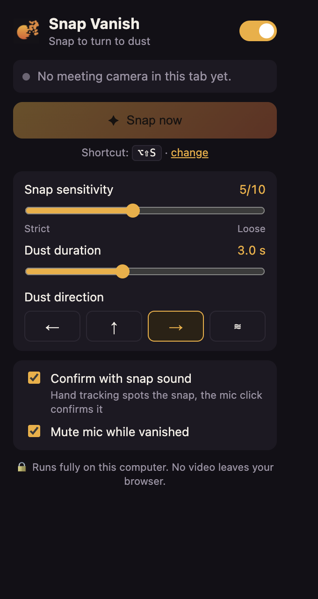

# 🫰 Thanos Snap Vanish (for Meetings)

**Snap your fingers on a video call and turn to dust.**

Thanos Snap Vanish is a free Chrome extension that recreates the most famous snap in movie history in your Google Meet calls. Snap your fingers on camera and you crumble into dust that blows away. Everyone else in the meeting sees an empty room where you were sitting, and your microphone mutes automatically. Snap again and the dust flies back together, you reappear, and your mic turns back on.

It runs entirely inside your browser. Your video never leaves your computer.



---

## ✨ Features

- 🫰 **Real finger-snap detection.** It watches your hand and only reacts to a real snap, not typing, waving, or scratching your head.
- 🔊 **Sound check.** The "click" of your snap on the mic is used to double-check that it really was a snap (you can switch this off).
- 💨 **Dust effect.** You break apart in patches, turn to ash, and drift away like in the movie.
- 🪑 **AI empty room.** The background behind you is rebuilt with AI, so people see a real-looking empty room, not a blurry outline or a black box.
- 🔇 **Auto-mute.** Your mic mutes the moment you vanish and unmutes when you come back.
- ↩️ **Snap back.** Snap again and the dust flies back in reverse as you reappear.
- 🎛️ **Simple controls.** An on/off switch, a **Snap now** button, and a keyboard shortcut (**Alt+Shift+S**) for when you don't want to snap.
- ⚙️ **Adjustable.** Choose snap sensitivity, how long the dust takes (1–6 seconds), and which way it blows (left, up, right, or random wind).
- 🔒 **Private.** Everything happens on your computer. No accounts, no tracking, no uploads.

---

## ✅ Compatibility

| | Status |
|---|---|
| **Google Meet** (meet.google.com in Chrome) | ✅ Supported |
| Microsoft Teams (web) | 🚧 Not supported yet. Early experimental code is included but untested |
| Zoom (web client) | 🚧 Not supported yet. Early experimental code is included but untested |
| Desktop apps (Teams, Zoom, etc.) | ❌ Not possible: browser extensions can't reach them |

**Browsers:** Google Chrome 116 or newer. Other Chromium browsers (Microsoft Edge, Brave, Arc) should work the same way but aren't officially tested. Safari and Firefox aren't supported.

**Computers:** Windows, macOS, Linux and ChromeOS. Any laptop from the last few years is fine. A computer with a decent graphics chip will run it more smoothly.

**You'll need:** a webcam, and ideally a microphone (for the snap sound check).

---

## 📦 How to install

You don't need to code anything. It takes about a minute.

1. **Download it.** On this GitHub page, click the green **Code** button, then **Download ZIP**. Unzip the file you downloaded.
   *(Or download `snap-vanish-meetings.zip` from the **Releases** section on the right and unzip that.)*
2. **Open your extensions page.** In Chrome, type `chrome://extensions` in the address bar and press Enter.
3. **Turn on Developer mode.** Use the switch in the top-right corner.
4. **Load the extension.** Click **Load unpacked** and choose the **`extension`** folder inside the folder you unzipped. *(If you used the Releases zip, choose the unzipped folder itself.)* The right folder is the one that contains a file called `manifest.json`.
5. **Pin it.** Click the puzzle-piece icon in Chrome's toolbar and click the pin next to **Snap Vanish**, so its icon is always visible.

That's it. You'll see the Snap Vanish icon next to the address bar.

> **Updating later:** download the new version, replace the old folder, then click the ↻ reload button on the extension's card in `chrome://extensions`.

---

## 🎬 How to use it

### Before the call
1. Open the extension's popup and check that the switch at the top is **on**.
2. Join or start your Google Meet call. **If the Meet tab was already open before you installed the extension, refresh the page first.**

### Warm it up (important!)
3. Sit in front of the camera for **5–10 seconds** and **lean left and right once or twice**. This lets the extension see the wall and furniture behind you. The popup will say *"Learning your room…"* and then *"Room fill ready."*

### Snap!
4. Raise one hand so the camera can see the whole hand, around chest-to-face height.
5. Press your **thumb and middle finger together**, with your ring and pinky fingers folded into your palm.
6. **Snap.** You'll turn to dust and blow away, and your mic will mute.
7. **Snap again** to come back. The dust flies back, you reappear, and your mic unmutes.

### If the snap doesn't register
- Click **Snap now** in the popup, or press **Alt+Shift+S** (you can change this at `chrome://extensions/shortcuts`).
- Try moving the **Snap sensitivity** slider higher.
- In a noisy room, or if your mic is off, turn off **Confirm with snap sound**.

### Settings explained

| Setting | What it does |
|---|---|
| **On/off switch** | Turns the extension on or off. After changing it, turn your camera off and on in Meet (or refresh) for it to take effect. |
| **Snap now** | Vanish or come back instantly, no snap needed. |
| **Snap sensitivity** | Low = strict (fewer accidental triggers). High = relaxed (catches softer snaps). |
| **Dust duration** | How long the dissolve takes, from 1 to 6 seconds. |
| **Dust direction** | Which way you blow away: left, up, right, or random wind. This is the direction **other people** see. Your self-view is mirrored, so "right" looks like left to you. |
| **Confirm with snap sound** | Requires the snap's click on your mic as well as the hand movement. Turn it off if it keeps missing your snaps. |
| **Mute mic while vanished** | Mutes your mic while you're gone. |

### Tips for the best effect
- 💡 Even, steady lighting works best. A bright window behind you makes the empty room harder to fake.
- 🪑 Lean around a little before snapping so the AI has more of the room to work with.
- ✋ Keep your whole hand in view when you snap.
- 🚶 While you're "gone," the empty room is a still picture of what's behind you, so avoid having people walk behind your chair.

---

## 🧠 How it was built (in plain English)

Here's what happens behind the scenes, step by step:

**1. It stands between your camera and Meet.**
Normally Google Meet reads your webcam directly. This extension steps in the middle: it takes your real camera feed, edits each frame, and hands the edited video to Meet. Meet doesn't know the difference. It just streams whatever the extension gives it.

**2. It watches your hand for a snap.**
A small AI model (Google's MediaPipe Hand Landmarker) finds 21 points on your hand, like your fingertips and knuckles, about 30 times a second. The extension looks for the exact pattern of a snap: thumb and middle finger pressed together, then the middle finger flicking down into your palm in a split second. Normal hand movements don't follow that pattern, so they're ignored.

**3. It listens for the click.**
At the same moment, it checks your microphone for a short, sharp "click" sound. If the hand movement **and** the click line up, it counts as a snap. It only listens for that one sound and never records anything.

**4. It finds you in the picture.**
A second AI model (MediaPipe Selfie Segmenter) works out which pixels are *you* and which are the room, like an automatic cut-out tool.

**5. It remembers your room.**
While you're on camera, the extension keeps a picture of everything behind you that it can see. Every time you move, it learns a bit more of the wall and furniture you were blocking.

**6. AI fills in the gaps.**
Some spots it never sees, like the chair right behind your back. For those, a third AI model called **MI-GAN** paints in what most likely belongs there, like a smart "content-aware fill" in a photo editor. This runs quietly in the background, so the empty room is ready the moment you snap.

**7. It turns you into dust.**
When you snap, the extension takes a snapshot of you and turns every pixel of your body into a tiny grain of dust. The grains peel off in patches, fade to grey ash, and drift away in the direction you picked. The empty room shows through behind them. To bring you back, it plays the same animation backwards.

**8. It mutes your mic.**
While you're gone, your microphone's sound is switched off before it reaches Meet. When you come back, it's switched on again.

**All of this happens on your own computer**, inside Chrome. All three AI models are packed inside the extension, so nothing is downloaded during a call and nothing is uploaded.

### The tech, for developers

| Part | Technology |
|---|---|
| Hand tracking | MediaPipe Tasks Vision: Hand Landmarker (WebGL GPU, CPU fallback) |
| Person cut-out | MediaPipe Tasks Vision: Selfie Segmenter |
| Room inpainting | MI-GAN (ONNX) on ONNX Runtime Web, in an offscreen extension page |
| Snap sound | High-pass transient detector on a private clone of the mic track (Web Audio) |
| Camera takeover | `getUserMedia` hook in the page → isolated content script → `canvas.captureStream()` |
| Dust effect | CPU particle system written directly into pixel buffers, closed-form so it can run in reverse |
| Packaging | Chrome Manifest V3, bundled with esbuild |

```
 Google Meet tab
 ┌───────────────────────────────────────────────────────────────┐
 │ page-hook.js (page world)                                     │
 │   catches the camera request → hands the real camera to the   │
 │   extension, gives Meet an edited video track instead         │
 │                         │                                     │
 │ content.js (extension's private world)                        │
 │   ├─ hand tracking   → snap-gesture.js  (+ click-ear.js mic)  │
 │   ├─ person cut-out  → mask of you                            │
 │   ├─ empty-room.js   → remembers the room behind you          │
 │   ├─ dust-storm.js   → dust dissolve / reform                 │
 │   └─ mic-switch.js   → mutes Meet's mic track                 │
 └──────────────────────────────┬────────────────────────────────┘
                                │ still images (never video)
 ┌──────────────────────────────▼────────────────────────────────┐
 │ offscreen page: MI-GAN paints in the hidden parts of the room │
 └───────────────────────────────────────────────────────────────┘
```

### Project layout

```
extension/            ← the folder you load in Chrome
  manifest.json
  scripts/            page-hook.js (hand-written), content.js + background.js (built)
  popup/              popup.html, popup.css, popup.js (built)
  inpainter/          offscreen page that runs MI-GAN
  models/             hand_landmarker.task, selfie_segmenter.tflite, migan.onnx
  wasm/, vendor/      MediaPipe and ONNX Runtime binaries
  icons/
src/                  source code for the built scripts
  content/            vanishing-act, snap-gesture, click-ear, empty-room, dust-storm, mic-switch, vision-models
  background/         service worker (keyboard shortcut, offscreen page)
  popup/              popup logic
  shared/             settings and message names
test/                 snap detector checks
tools/                icon generator, zip packager
build.mjs             build script
```

### Building from source (optional)

The `extension/` folder already contains everything built, so you only need this if you change the code. Requires [Node.js](https://nodejs.org) 18+.

```bash
npm install
npm run build      # bundles src/ into extension/
npm test           # snap detector checks
npm run package    # creates snap-vanish-meetings.zip
```

---

## 🛠️ Troubleshooting

| Problem | Fix |
|---|---|
| Nothing happens and the popup says *"No meeting camera in this tab yet"* | Refresh the Meet tab, then turn your camera on. |
| The popup is stuck on *"Loading…"* | Give it 5–10 seconds after your camera turns on. On older computers, the first load takes a little longer. |
| My snaps aren't detected | Keep your whole hand in view, raise **Snap sensitivity**, or turn off **Confirm with snap sound**. You can always use **Snap now** or **Alt+Shift+S**. |
| It triggers when I don't want it to | Lower **Snap sensitivity** and keep **Confirm with snap sound** on. |
| A blurry patch shows where I was sitting | Lean left and right for a few seconds before snapping so it can learn more of your room. |
| Meet still shows my mic as on while I'm gone | That's expected. The extension silences your audio directly, so others hear nothing, but Meet's own mic icon doesn't change. |
| The keyboard shortcut doesn't work | Another app may be using it. Pick a new one at `chrome://extensions/shortcuts`. |
| My camera looks normal and nothing works | Make sure the extension's switch is on, then turn your camera off and on again in Meet. |

---

## 🔒 Privacy

- **No video, audio or images ever leave your computer.** All AI models run inside Chrome.
- **No accounts, analytics, ads or tracking.** The extension makes no network requests.
- The only thing it saves is your settings (like sensitivity), in Chrome's own storage.
- It only runs on meeting websites (`meet.google.com`, plus the Teams and Zoom web addresses for the upcoming experimental support). It can't see any other site you visit.

---

## ⚠️ Known limitations

- **Google Meet only** for now (see Compatibility).
- Meet's own mute icon won't change while you're vanished, even though your audio is silenced.
- If the Meet tab was open before you installed the extension, refresh it.
- The empty room is a still image of what's behind you, so big changes behind you (people walking past, lights switching) won't show while you're gone.
- On slower computers the video may look a little less smooth while the effect runs.

---

## 🗺️ Roadmap

- Full support for Microsoft Teams and Zoom on the web
- Show the meeting's own mute icon as muted
- More effects (portal, fade-to-smoke, teleport)
- Chrome Web Store release

---

## 📄 Credits and licence

Released under the **MIT licence** (see [`LICENSE`](LICENSE)). It bundles open-source AI models and runtimes under their own licences, listed in [`THIRD_PARTY_NOTICES.md`](THIRD_PARTY_NOTICES.md): Google MediaPipe (Apache-2.0), Microsoft ONNX Runtime (MIT) and Picsart MI-GAN (MIT).

*Fan-made project for fun. Not affiliated with or endorsed by Marvel, Disney, Google, Microsoft or Zoom. "Thanos" is a trademark of Marvel.*
